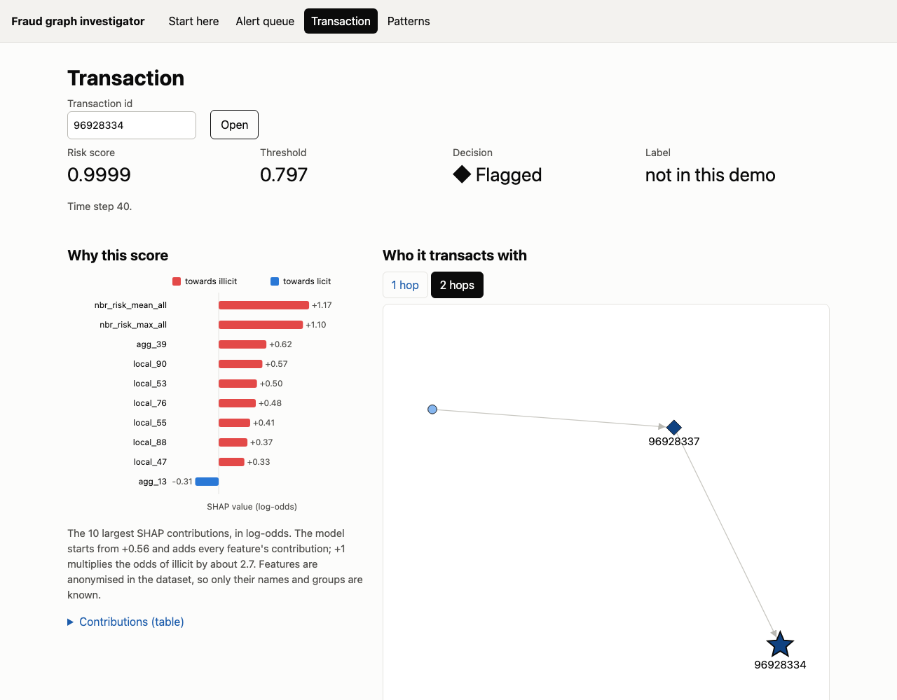
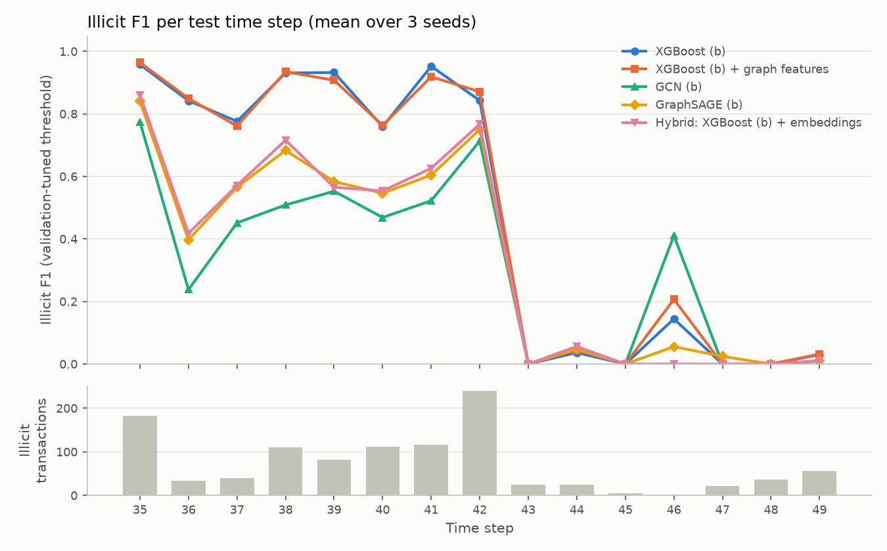
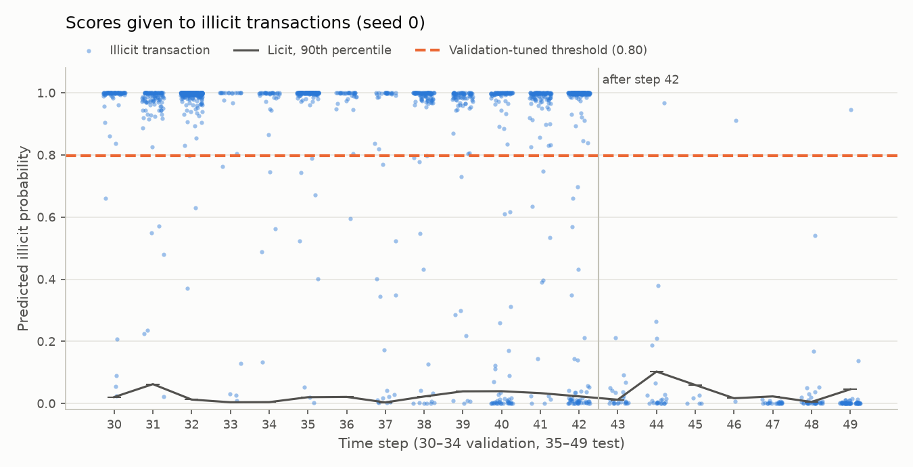
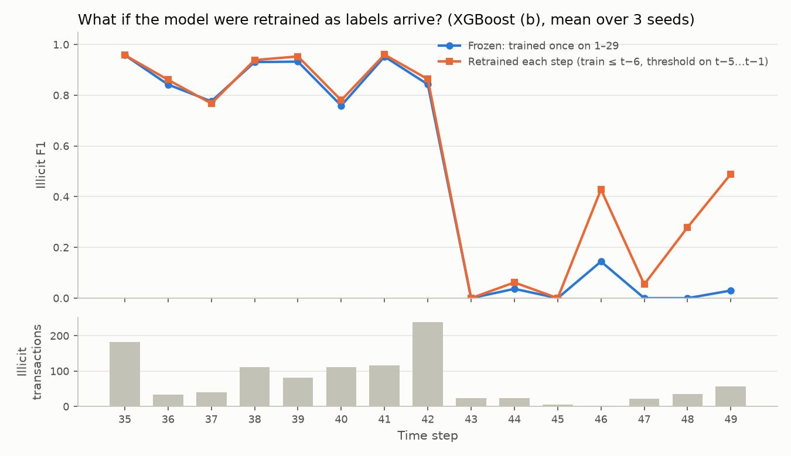
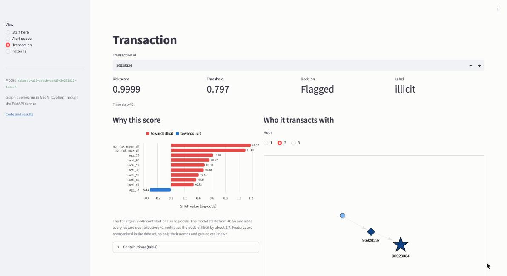

# fraud-graph-detection

Detecting illicit Bitcoin transactions with graph machine learning, evaluated under a strict
temporal split. Does graph structure help, and does the answer hold over time?

[](https://vincentgoh0902.github.io/fraud-graph-detection/)
&nbsp;**[Open the live demo](https://vincentgoh0902.github.io/fraud-graph-detection/)**: static, opens instantly, works on a phone.

<a href="https://vincentgoh0902.github.io/fraud-graph-detection/"></a>

## In short

- **Graph structure did not help.** XGBoost on the dataset's own features matched or beat
  engineered Neo4j graph features, GCN, GraphSAGE and a GNN-embedding hybrid.
- **Every model collapses after the dark-market shutdown at step 43.** The analysis shows
  why: the new illicit transactions look licit in their own features *and* in their
  neighbourhoods, so no model, graph-based or not, ranks them as risky.
- **Input-drift alarms could not have flagged it.** Six anonymised features act as hidden
  clocks, so any two periods look different, even two stretches of the training data.
- **What helps is retraining on new labels, not a different model**, and only once labels
  from the new pattern exist.

## Results

The strongest tabular model against the best of each graph approach, all on the full
Elliptic feature set (b). Higher PR-AUC is better; an interval that excludes zero means the
change is larger than step-to-step noise.

<!-- headline:start -->
| Model | Test PR-AUC | Change vs XGBoost (b) [95% interval] | Resamples where it wins |
|---|---|---|---|
| XGBoost (b) | 0.791 ± 0.000 | – | – |
| XGBoost (b) + graph features | 0.795 ± 0.001 | +0.004 [-0.005, +0.013] | 85% |
| GraphSAGE (b) | 0.526 ± 0.031 | -0.265 [-0.383, -0.174] | 0% |
| Hybrid: XGBoost (b) + embeddings | 0.649 ± 0.028 | -0.142 [-0.247, -0.083] | 0% |

Test steps 35–49, mean ± std over 3 seeds. Change: test PR-AUC minus that of XGBoost (b), with a 95% interval from a paired bootstrap (1000 resamples of the 15 test steps, both models scored on the same resample). Resamples where it wins: the share in which the model beats XGBoost (b).
<!-- headline:end -->

Every table and figure in this README and in [`docs/results.md`](docs/results.md) is
generated from logged MLflow runs by `scripts/make_results_table.py`, not typed by hand.
The full tables (every model, both feature sets, decision thresholds, checkpoints, the
collapse analysis and serving latency) are in [`docs/results.md`](docs/results.md).

## How it was evaluated

- **Data:** the [Elliptic Bitcoin dataset](https://www.kaggle.com/datasets/ellipticco/elliptic-data-set)
  (Weber et al., 2019): 203,769 transactions (nodes), 234,355 payment flows (edges),
  49 time steps about two weeks apart; 4,545 illicit and 42,019 licit labels (~2% of all
  transactions are labelled illicit), the rest unknown. Features are anonymised.
- **Temporal split:** train on time steps 1–29, select models and thresholds on 30–34,
  test on 35–49, scored once. Unknown-label transactions stay in the graph but are left out
  of the loss and the metrics.
- **Metrics:** PR-AUC as the primary metric because of class imbalance, plus illicit
  precision, recall and F1, and precision@20 and recall@20 per time step.
- **Models:** logistic regression, random forest, XGBoost, GCN, GraphSAGE, and a hybrid
  (GNN embeddings + XGBoost). 3 seeds for every stochastic model, reported as mean ± std.
- **Feature sets:** (a) the 93 local features; (b) all 165 Elliptic features, local +
  aggregated; (c) local + graph features from Neo4j Graph Data Science (PageRank, Louvain
  communities, neighbour risk). Neighbour risk comes from a model's *predicted* risk, never
  from labels, which are unavailable at prediction time.

## Why graphs didn't help



**Engineered graph features.** On top of all Elliptic features, our graph features give no
improvement that can be told apart from zero: the bootstrap interval for the PR-AUC change
includes zero, and the precision@20 interval only just reaches it. Graph shape on its own adds
nothing. Graph information does help in one form, neighbourhood statistics: the dataset's
aggregated features clearly improve on local features, and our graph features, which include
risk averaged over neighbours, improve on local features by a similar amount when used
*instead* of them. So the graph information is real but already captured by Elliptic's
aggregated features. The intervals are approximate with only 15 test steps. GNNs use the
graph differently, so this result is about engineered graph features, not graph learning in
general.

**Graph neural networks.** This is a negative result, and a clear one.
- **GNNs lose to XGBoost.** The best GNN, GraphSAGE on local features, reaches test PR-AUC
  0.577 against XGBoost's 0.778 on the same features. On both feature sets the bootstrap
  interval for the change is well below zero.
- **The hybrid is worse than XGBoost alone.** Adding GraphSAGE embeddings lowers test
  PR-AUC from 0.791 to 0.649 on (b), and from 0.778 to 0.673 on (a). It is also lower on
  *validation* (0.966 vs 0.990 on (b)), so the protocol would never have chosen it; it is
  scored on test only because the comparison was fixed in advance. A likely cause is the
  in-sample embeddings: GraphSAGE's PR-AUC on its own training nodes is 0.998 on (b)
  but 0.957 on validation, so XGBoost learns from embeddings that are cleaner than the
  ones it is scored on. That explanation fits the numbers but has not been tested.
- **The GNNs drop much more from validation to test.** GraphSAGE goes from 0.956 to 0.577,
  XGBoost from 0.988 to 0.778. The gap opens *before* the late collapse: in steps 36–41
  GraphSAGE's F1 is 0.40–0.68 where XGBoost's is 0.76–0.95. After step 42 every model
  collapses alike (next section).
- **GraphSAGE is ahead of GCN** on both feature sets, on validation (0.956 vs 0.909 on (a),
  0.957 vs 0.897 on (b)) and on test. The test gap is outside bootstrap noise on (b), but
  only just (+0.062, interval [+0.012, +0.115]), and within it on (a) (+0.095, interval
  [−0.064, +0.245]): the gap on (a) is larger on average but varies more from step to step.
  The intervals are not corrected for the six planned comparisons and rest on 15 test
  steps, so "probably ahead, by a modest margin" is as far as this goes. GraphSAGE keeps a
  separate weight for a transaction's own features while GCN averages them with its
  neighbours'. That may matter when most neighbours are unlabelled or licit, but it is a
  hypothesis, not a tested result.
- **Aggregated features do not help the GNNs** (GraphSAGE 0.577 on (a), 0.526 on (b)), which
  is plausible because a GNN computes its own neighbourhood aggregates. This pair was not
  in the planned bootstrap comparisons, so treat it as an observation.
- **Focal loss vs weighted cross-entropy makes no difference** on validation: the best
  setting of each is within 0.004.

On Elliptic's temporal split, neither engineered graph features nor graph neural networks
improve on XGBoost with the dataset's own features. The original Elliptic paper (Weber et al.,
2019) also found random forest ahead of GCN. One limitation: one GCN setting was still
improving at the 500-epoch cap. That affects only which GCN setting wins, not GCN's place
behind XGBoost.

## The dark-market collapse

**Answer to the research question.** No. Neither engineered graph features nor graph neural
networks improve on XGBoost with the dataset's own features, and the answer does not change
over time: before the dark-market shutdown the GNNs are clearly worse, and after it every
model fails alike. The test period is split at the shutdown that Weber et al. (2019) report
at step 43: *before* is steps 35–42, *after* is 43–49. The numbers below are quoted from the
generated tables in [`docs/results.md`](docs/results.md#the-dark-market-collapse-in-full).



1. **The collapse after step 42 is a ranking failure, not a threshold problem.** The selected
   model (XGBoost on (b) + graph features) misses 166 of the 169 illicit transactions in steps
   43–49. Their median score is 0.002, about where the licit transactions' 90th percentile sits,
   so the model ranks them like licit ones. Even the best threshold chosen with each step's own
   labels (a diagnostic ceiling, not a result) reaches only F1 0.21, against 0.90 before the
   shutdown.
2. **The model's reasoning stays the same; the transactions change.** SHAP shares by feature
   group stay stable from training to after the shutdown (local 61% → 56%, aggregated 30% →
   36%), and per-feature importance ranks correlate 0.96–0.97 with training. Missed illicit
   transactions have licit-looking local features (mean SHAP −3.1 log-odds, vs +4.9 for caught
   ones) and licit-looking neighbourhoods (median neighbour risk 0.002 vs 0.089).
3. **Drift measures cannot isolate the shutdown, because six features are hidden clocks.**
   `agg_7`, `agg_8`, `agg_10`, `agg_43`, `agg_44` and `agg_46` rise steadily with the time step,
   so the time is in the data even though `time_step` is not a feature. Because of them,
   *any* two periods can be told apart: a classifier separates two stretches of the
   training period itself with AUC 0.999 (a control added after the first results). The
   model barely uses the clocks (SHAP rank 36–76 of 174), so this generic drift is not what
   broke it. The features are anonymised, so what did change after step 42 cannot be named.
4. **The graph does not rescue the late steps.** GraphSAGE (b) and the hybrid flag 0–1 of
   XGBoost's 166 late misses. Their deficit to XGBoost lies entirely in steps 35–42 (e.g.
   GraphSAGE (b): −0.245 PR-AUC before, −0.001 after). Graph features on top of (b) show
   +0.008 PR-AUC after the shutdown, with an interval above zero, but on a base of 0.04 PR-AUC
   that changes nothing in practice.
5. **The misses are systematic.** 300 of the 1,083 illicit test transactions are missed by all
   three seeds and only 19 depend on the seed. Even before the shutdown, misses are confident
   (median score 0.013 against a threshold of about 0.78), not near-misses.
6. **Retraining helps, but only once new labels exist** (a what-if that uses test-period
   labels). Retraining before every step lifts F1 after the shutdown from 0.024 to 0.268.
   Steps 43–45 stay near zero; by step 49, F1 is 0.49 and PR-AUC 0.71. It assumes labels
   arrive instantly, so it is an optimistic bound.

   

**Limitations.** After step 42 there are only 169 illicit transactions (steps 45 and 46 have 5
and 2), so per-step numbers there are noisy; the tables give counts next to every metric. The
missed-vs-caught feature contrast mixes periods: misses are concentrated after the shutdown, so
clock features appear in it for that reason alone. Recall@20 is capped when a step has more than
20 illicit transactions, which is why it is low even where F1 is high. Neighbour-risk features
already drift on validation (median PSI 0.46), which fits the known limitation of using
predicted rather than true neighbour labels, but cannot be separated from real change here.

## Demo

**[https://vincentgoh0902.github.io/fraud-graph-detection/](https://vincentgoh0902.github.io/fraud-graph-detection/)**:
the guided tour, the alert queue, transaction detail with SHAP and the payment neighbourhood,
and communities. It works on a phone, needs no backend, and never sleeps. It shows the
dashboard's views on a public subset: scores and SHAP values for steps 35–49, and payment
edges only around each step's top 20 alerts. It has no features, no labels and no full edge
list. Paths and fan-in need the whole graph, so they are full-stack only.

**Same numbers as the dashboard.** The site's JSON is generated at build time by
`ServingService`, the dashboard's own code. A parity test compares every generated file with
fresh service output: every alert list, neighbourhood and community, and all 67,504
transactions. The page formats numbers exactly as Python does, which a test checks against
Python, including exact ties such as 0.625.

**No data in git.** The `Pages` workflow (`.github/workflows/pages.yml`) downloads the pinned
dataset revision from Hugging Face, runs the site tests (leak check, parity, formatting),
builds the site, smoke-tests it in headless Chrome, and deploys it as a Pages artifact. The
leak check fails the build on any label, any feature column, any unknown field or any edge
outside the shipped subset.

**Small.** Plain HTML, CSS and JavaScript modules with no framework and no runtime
dependencies. The first screen loads 40 KB, 15 KB gzipped. A step's alert file is at most
15 KB gzipped, and a transaction's SHAP shard about 44 KB, fetched when opened. The
neighbourhood graph is SVG with node positions computed at build time.

*Optional second demo.* The same dashboard can run on Streamlit Community Cloud; it sleeps
when idle, so it is not the main link. Entrypoint `dashboard/app.py`, Python 3.12,
requirements `dashboard/requirements.txt`, and two secrets:

```toml
DEMO_DATASET_REPO = "vincentgoh-kaiswee/fraud-graph-detection-demo"
DEMO_DATASET_REVISION = "d87c8399deb7d66c575115f45edc201200614984"
```

## Serving



An investigator's view of the served model (seed 0 of XGBoost on (b) + graph, the model
selected on validation) for the out-of-sample steps 35–49. It has an alert queue per step, a
SHAP explanation per transaction, the payment neighbourhood coloured by risk, and the Cypher
investigation queries. The dashboard opens on a short guided tour: one strong alert before
the shutdown, then the steps after it, where the model misses almost everything.

```
offline (uv, Mac)                          docker compose up (all ports on 127.0.0.1)
scripts/export_serving.py ─► artifacts/ ─► api (FastAPI) ─► Neo4j: Cypher queries
  scores + SHAP, checked against MLflow        ▲
scripts/write_predictions.py ─► Neo4j          dashboard (Streamlit)
```

**Why scores are precomputed, not computed at startup.** The brief says to load the models
and score at startup. Elliptic is historical, so the transactions and the model are fixed and
the scores never change. An offline export computes them once and checks that they equal the
test scores logged in MLflow, so the app shows exactly the model this README reports. The
serving images then need neither XGBoost nor the feature table. The API, Neo4j and the public
demo all serve the same file. The cost is that the app cannot score a new, unseen
transaction, which this fixed benchmark does not need.

**Endpoints** (OpenAPI docs at `/docs`)

| Endpoint | Returns |
|---|---|
| `GET /transactions/{tx_id}` | risk score, flag at the validation threshold, label, top 10 SHAP contributions |
| `GET /transactions/{tx_id}/neighbourhood?hops=2` | the subgraph up to 3 hops, risk per node, at most 500 nodes (nearest hops first, then riskiest) |
| `GET /alerts?time_step=40&k=20` | the k riskiest transactions of a step (k ≤ 100) |
| `GET /paths?source=…&target=…` | all shortest payment paths up to 6 hops |
| `GET /communities?time_step=40` | Louvain communities ranked by their share of flagged transactions |
| `GET /fan-in?time_step=40` | transactions paid by several flagged transactions |
| `GET /steps`, `/meta`, `/health` | per-step summary, model version and limits, liveness |

The same queries run on two interchangeable backends: Cypher in Neo4j for the full stack, and
NetworkX on the exported files for the demo and for CI. A test checks that both give
identical answers on the real graph. Latency per endpoint on both backends is in
[`docs/results.md`](docs/results.md#serving-latency).

Memory in use after start-up, measured with `docker stats` on the Mac: Neo4j about 2.1 GB,
API about 300 MB, dashboard about 50 MB. The public demo runs the dashboard with its data
in-process and peaks at about 300 MB.

## Reproduce

Requires [uv](https://docs.astral.sh/uv/) and Docker.

```bash
uv sync                      # install dependencies
cp .env.example .env         # then set NEO4J_PASSWORD
docker compose up -d neo4j   # Neo4j browser at http://localhost:7474
uv run pytest
```

**Data** (needs a Kaggle API token in `~/.kaggle/`):

```bash
uv run python scripts/download_data.py   # ~150 MB download; verifies SHA-256 checksums
```

The loader (`src/fraudgraph/data/load.py`) validates every load against the published
counts and checks that no edge crosses time steps, which the temporal split relies on.

**Experiments**, in order:

```bash
uv run python scripts/run_experiment.py                         # tabular baselines
uv run python scripts/load_neo4j.py                             # transactions and payment edges
uv run python scripts/build_graph_features.py                   # or --backend networkx without Neo4j
uv run python scripts/run_experiment.py --config graph_features
uv run python scripts/run_experiment.py --config gnn
uv run python scripts/run_experiment.py --config hybrid         # a separate process: torch and XGBoost cannot share one
uv run python scripts/run_analysis.py                           # the collapse analysis
uv run python scripts/make_results_table.py                     # README and docs/results.md tables and figures
```

Browse runs with `uv run mlflow ui --backend-store-uri sqlite:///mlruns/mlflow.db`.

**Serving stack:**

```bash
uv run python scripts/export_serving.py       # scores + SHAP for steps 35-49, checked vs MLflow
docker compose up -d neo4j
uv run python scripts/load_neo4j.py           # once: transactions and payment edges
uv run python scripts/write_predictions.py    # risk_score, predicted_label, model_version, community_id
docker compose up -d --build api dashboard    # API on :8000, dashboard on :8501
```

Set `API_HOST_PORT` or `DASHBOARD_HOST_PORT` in `.env` if 8000 or 8501 is taken on your machine.

**Static site:**

```bash
uv run python scripts/build_site.py                 # downloads the pinned revision
uv run python scripts/build_site.py --data artifacts/space   # or a local demo export
python -m http.server -d build/site 8000            # preview
scripts/smoke_site.sh                               # headless Chrome check
```

## Project structure

```
src/fraudgraph/   data loading and split, features, models, evaluation, analysis, serving, site build
scripts/          entry points: download, experiments, analysis, results tables, serving, site
configs/          YAML configs for every experiment, the split and serving
tests/            pytest suite, including leak and parity checks for the demo
notebooks/        exploratory data analysis
dashboard/        Streamlit investigator dashboard
site/             static demo: plain HTML, CSS and ES modules
docker/           API and dashboard images (docker-compose.yml at the root)
hub/              dataset card for the public demo data on Hugging Face
docs/             results.md (full tables), decisions.md, PROJECT_BRIEF.md, figures/
```

The reasoning behind each design choice is in [`docs/decisions.md`](docs/decisions.md).

## Data and licence

[Elliptic Bitcoin dataset](https://www.kaggle.com/datasets/ellipticco/elliptic-data-set)
from Kaggle, published by Elliptic.

**Licence:** [CC BY-NC-ND 4.0](https://creativecommons.org/licenses/by-nc-nd/4.0/).
The data is not included in this repository and must be downloaded separately.

**Citation:** M. Weber, G. Domeniconi, J. Chen, D. K. I. Weidele, C. Bellei,
T. Robinson, C. E. Leiserson, "Anti-Money Laundering in Bitcoin: Experimenting with
Graph Convolutional Networks for Financial Forensics", KDD '19 Workshop on Anomaly
Detection in Finance, 2019. Data: Elliptic, www.elliptic.co.
