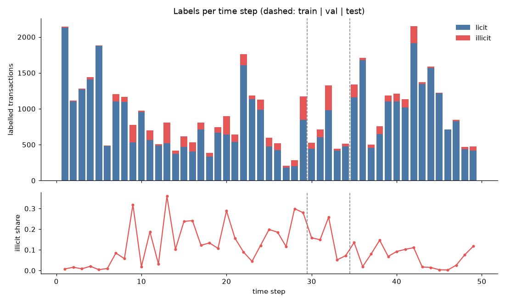
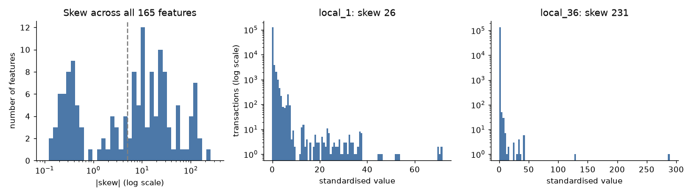
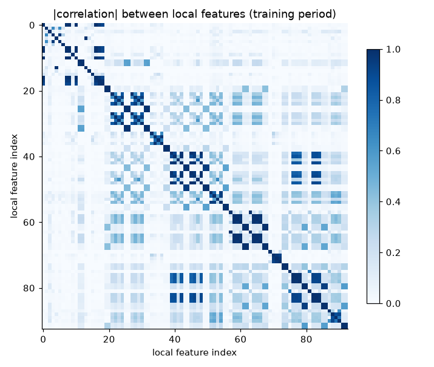
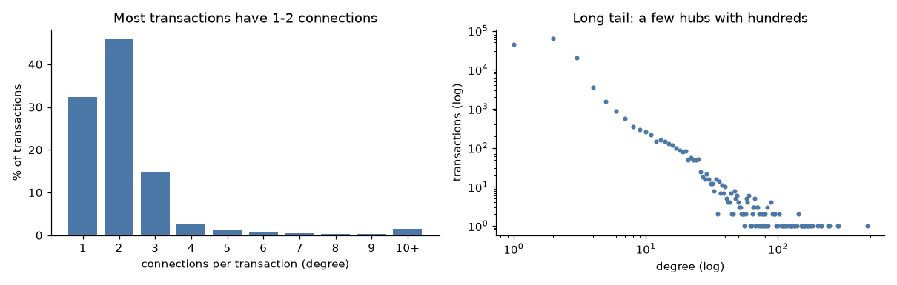
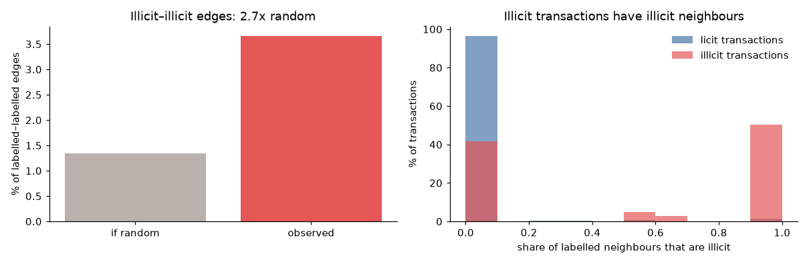
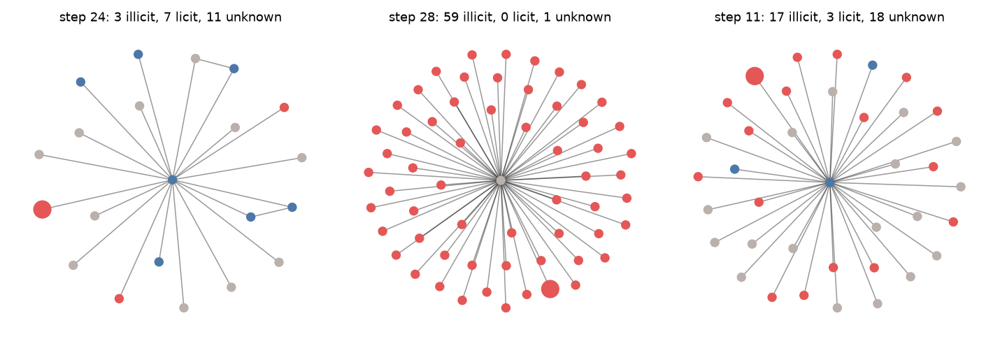

# fraud-graph-detection

Detecting illicit Bitcoin transactions with graph machine learning, evaluated
under a strict temporal split.

**Research question:** does graph structure (GNN embeddings or graph features)
improve illicit-transaction detection over tabular features alone, and does that
improvement hold over time?

> Status: Phase 3 (Neo4j graph features). Results, plots and a live demo will appear here as the
> project progresses. Every number in this README will be generated from logged
> experiment runs, not typed by hand.

## Approach (planned)

- **Data:** Elliptic Bitcoin dataset (Weber et al., 2019): ~200k transactions,
  49 time steps, ~2% labelled illicit.
- **Evaluation:** train on time steps 1–29, select models and thresholds on 30–34,
  test on 35–49; PR-AUC as the primary metric because of class imbalance;
  per-time-step analysis of drift.
- **Models:** logistic regression, random forest, XGBoost, GCN, GraphSAGE, and a
  hybrid (GNN embeddings + XGBoost).
- **Graph features and investigation:** Neo4j Graph Data Science (PageRank,
  Louvain communities, neighbour risk) and Cypher queries for an investigator
  dashboard.

Design decisions and their reasoning are recorded in [`docs/decisions.md`](docs/decisions.md).

## Setup

Requires [uv](https://docs.astral.sh/uv/) and Docker.

```bash
uv sync                      # install dependencies
cp .env.example .env         # then set NEO4J_PASSWORD
docker compose up -d neo4j   # Neo4j browser at http://localhost:7474
uv run pytest
```

## Data

[Elliptic Bitcoin dataset](https://www.kaggle.com/datasets/ellipticco/elliptic-data-set)
from Kaggle, published by Elliptic: 203,769 transactions (nodes), 234,355 payment
flows (edges), 49 time steps about two weeks apart; 4,545 illicit and 42,019 licit
labels, the rest unknown. Features are anonymised.

**Licence:** [CC BY-NC-ND 4.0](https://creativecommons.org/licenses/by-nc-nd/4.0/).
The data is not included in this repository and must be downloaded separately.

**Citation:** M. Weber, G. Domeniconi, J. Chen, D. K. I. Weidele, C. Bellei,
T. Robinson, C. E. Leiserson, "Anti-Money Laundering in Bitcoin: Experimenting with
Graph Convolutional Networks for Financial Forensics", KDD '19 Workshop on Anomaly
Detection in Finance, 2019. Data: Elliptic, www.elliptic.co.

**Download** (needs a Kaggle API token in `~/.kaggle/`):

```bash
uv run python scripts/download_data.py   # ~150 MB download; verifies SHA-256 checksums
```

The loader (`src/fraudgraph/data/load.py`) validates every load against the published
counts and checks that no edge crosses time steps, which the temporal split relies on.

## EDA findings

From [`notebooks/01_eda.ipynb`](notebooks/01_eda.ipynb). All findings use the training
period (steps 1–34) except the timeline, which is shown for context only.



- **The illicit share varies a lot between steps,** from under 1% to 36% of labelled
  transactions within the training period. Illicit counts per step range from 5 to 342
  (median 84). Late in the timeline, illicit labels almost vanish (from 239 in step 42
  to between 2 and 24 in steps 43–47), consistent with the dark market shutdown reported
  by Weber et al. Phase 5 investigates this.
- **Precision@K uses K = 20.** With K = 100, 59% of training steps have fewer than 100
  illicit transactions, so even a perfect model could not reach precision 1 there
  ([D-004](docs/decisions.md)).
- **The features are already standardised** (column means ≈ 0, standard deviations ≈ 1)
  but heavily skewed: 85 of 165 have |skew| > 5. There are no constant columns, but 45
  feature pairs are near-duplicates (|r| > 0.99). This matters for logistic regression
  (unstable coefficients), not for tree models.

  
  
- **The graph is sparse and each time step is one connected component** (verified for
  all 34 training steps). Each step has about 4,000 transactions and 4,600 edges;
  78% of transactions have only 1 or 2 connections, and the busiest has 473.

  
- **There is strong homophily.** Between labelled transactions, illicit–illicit edges
  occur 2.7× more often than random pairing predicts. An illicit transaction's labelled
  neighbours are on average 55% illicit, a licit one's only 2%. So the graph carries
  signal, but 21% of labelled transactions have no labelled neighbour, and labels can't
  be used at prediction time anyway (D-001). Graph models have to work from features
  and predicted risk.

  
  

## Results

### Phase 2: tabular baselines

Logistic regression, random forest and XGBoost on feature sets (a) local and
(b) local + aggregated. Each model's settings were chosen from a small grid by mean
validation PR-AUC (steps 30–34), and the decision thresholds were tuned on validation
too; test steps 35–49 were scored once, with the chosen model
([D-009](docs/decisions.md), [D-014](docs/decisions.md)). Generated by
`scripts/make_results_table.py` from the MLflow runs.

<!-- results:start -->
**Ranking quality** (test steps 35–49; precision/recall@K are per-step means)

| Model | Features | Seeds | Val PR-AUC | Test PR-AUC | Precision@20 | Recall@20 |
|---|---|---|---|---|---|---|
| Logistic regression | (a) local | 1 | 0.836 | 0.267 | 0.133 | 0.083 |
| Random forest | (a) local | 3 | 0.989 ± 0.000 | 0.781 ± 0.001 | 0.543 ± 0.000 | 0.176 ± 0.000 |
| XGBoost | (a) local | 3 | 0.988 ± 0.000 | 0.778 ± 0.003 | 0.550 ± 0.000 | 0.181 ± 0.001 |
| Logistic regression | (b) local + aggregated | 1 | 0.770 | 0.231 | 0.107 | 0.074 |
| Random forest | (b) local + aggregated | 3 | 0.990 ± 0.000 | 0.786 ± 0.004 | 0.545 ± 0.002 | 0.177 ± 0.001 |
| XGBoost | (b) local + aggregated | 3 | 0.990 ± 0.001 | 0.791 ± 0.000 | 0.553 ± 0.003 | 0.182 ± 0.002 |

**Decisions at the validation-tuned threshold** (left: max-F1 threshold; right: cost threshold, a miss costs 10× a false alarm)

| Model | Features | Seeds | Precision | Recall | F1 | Precision (cost) | Recall (cost) | F1 (cost) |
|---|---|---|---|---|---|---|---|---|
| Logistic regression | (a) local | 1 | 0.442 | 0.641 | 0.523 | 0.199 | 0.804 | 0.319 |
| Random forest | (a) local | 3 | 0.782 ± 0.031 | 0.725 ± 0.007 | 0.752 ± 0.011 | 0.573 ± 0.022 | 0.748 ± 0.002 | 0.649 ± 0.014 |
| XGBoost | (a) local | 3 | 0.775 ± 0.012 | 0.713 ± 0.003 | 0.742 ± 0.007 | 0.459 ± 0.089 | 0.763 ± 0.018 | 0.569 ± 0.065 |
| Logistic regression | (b) local + aggregated | 1 | 0.276 | 0.706 | 0.396 | 0.177 | 0.835 | 0.292 |
| Random forest | (b) local + aggregated | 3 | 0.886 ± 0.032 | 0.710 ± 0.006 | 0.788 ± 0.014 | 0.592 ± 0.048 | 0.740 ± 0.001 | 0.657 ± 0.030 |
| XGBoost | (b) local + aggregated | 3 | 0.841 ± 0.009 | 0.731 ± 0.001 | 0.782 ± 0.003 | 0.688 ± 0.109 | 0.743 ± 0.007 | 0.711 ± 0.055 |

Mean ± sample standard deviation over seeds.
<!-- results:end -->

Reproduce with `uv run python scripts/run_experiment.py`, then
`uv run python scripts/make_results_table.py`. Browse runs with
`uv run mlflow ui --backend-store-uri sqlite:///mlruns/mlflow.db`.

### Phase 3: Neo4j graph features

XGBoost (the same 8-setting grid and 3 seeds as Phase 2, [D-014](docs/decisions.md)) on
three graph feature sets ([D-003](docs/decisions.md), [D-021](docs/decisions.md)):

- **(c) local + graph:** the 93 local features plus in/out degree, PageRank, clustering
  coefficient, Louvain community size and density (computed by Neo4j Graph Data Science),
  and community and neighbour risk.
- **(b) + graph:** all 165 Elliptic features plus the same graph features. Graph features
  only help if this beats (b), because the 72 aggregated features are already
  neighbourhood statistics.
- **Local + structure only:** the graph's shape without any risk feature, to separate
  structure from risk passed along edges.

Neighbour and community risk use a stage-1 XGBoost model's *predicted* risk, not labels:
test transactions only connect to other test transactions, whose labels are unknown at
prediction time. Training transactions are scored out-of-fold by time step, so no
transaction's risk comes from a model that saw its time step
([D-001](docs/decisions.md), [D-018](docs/decisions.md)). Louvain communities turned out to
cover most of a time step (median 5 per step, the largest holding 81% of the step on
average), so the community features say more about the step than about a local group
([D-023](docs/decisions.md)).

<!-- results-phase3:start -->
**Ranking quality** (test steps 35–49; precision/recall@K are per-step means)

| Model | Features | Seeds | Val PR-AUC | Test PR-AUC | Precision@20 | Recall@20 |
|---|---|---|---|---|---|---|
| XGBoost | (c) local + graph | 3 | 0.993 ± 0.001 | 0.788 ± 0.001 | 0.552 ± 0.002 | 0.180 ± 0.001 |
| XGBoost | (b) + graph | 3 | 0.994 ± 0.000 | 0.795 ± 0.001 | 0.562 ± 0.002 | 0.187 ± 0.001 |
| XGBoost | local + structure only | 3 | 0.990 ± 0.000 | 0.776 ± 0.001 | 0.550 ± 0.003 | 0.179 ± 0.002 |

**Decisions at the validation-tuned threshold** (left: max-F1 threshold; right: cost threshold, a miss costs 10× a false alarm)

| Model | Features | Seeds | Precision | Recall | F1 | Precision (cost) | Recall (cost) | F1 (cost) |
|---|---|---|---|---|---|---|---|---|
| XGBoost | (c) local + graph | 3 | 0.808 ± 0.036 | 0.718 ± 0.009 | 0.760 ± 0.011 | 0.607 ± 0.029 | 0.745 ± 0.004 | 0.669 ± 0.016 |
| XGBoost | (b) + graph | 3 | 0.893 ± 0.021 | 0.715 ± 0.005 | 0.794 ± 0.005 | 0.705 ± 0.079 | 0.737 ± 0.009 | 0.719 ± 0.039 |
| XGBoost | local + structure only | 3 | 0.769 ± 0.019 | 0.705 ± 0.002 | 0.736 ± 0.007 | 0.547 ± 0.072 | 0.741 ± 0.013 | 0.627 ± 0.045 |

Mean ± sample standard deviation over seeds.

**XGBoost: what each feature set adds** (test steps 35–49; change = difference of seed means)

| From | To | test PR-AUC: from → to (change) | precision@20: from → to (change) | F1 (max-F1 threshold): from → to (change) |
|---|---|---|---|---|
| (a) local | (b) local + aggregated | 0.778 → 0.791 (+0.013) | 0.550 → 0.553 (+0.003) | 0.742 → 0.782 (+0.039) |
| (a) local | (c) local + graph | 0.778 → 0.788 (+0.010) | 0.550 → 0.552 (+0.002) | 0.742 → 0.760 (+0.018) |
| (a) local | local + structure only | 0.778 → 0.776 (-0.002) | 0.550 → 0.550 (+0.000) | 0.742 → 0.736 (-0.007) |
| (b) local + aggregated | (b) + graph | 0.791 → 0.795 (+0.004) | 0.553 → 0.562 (+0.009) | 0.782 → 0.794 (+0.012) |
<!-- results-phase3:end -->

**Reading it.** Graph features give a small gain on top of all Elliptic features, smaller
than the gain the provided aggregated features give on top of local ones. Graph shape on
its own adds nothing: the structure-only set is no better than local features. What helps
is risk passed along edges, a stage-1 model's predictions averaged over neighbours and
communities. The gains are larger than the seed spread, but the seed spread does not cover
the uncertainty from having only 15 test steps, or from the single stage-1 seed
([D-018](docs/decisions.md)). Whether the gain survives the late-timeline collapse is
analysed per step in Phase 5.

Reproduce with `docker compose up -d neo4j`, `uv run python scripts/load_neo4j.py`,
`uv run python scripts/build_graph_features.py` (or `--backend networkx` without Neo4j),
then `uv run python scripts/run_experiment.py --config graph_features` and
`uv run python scripts/make_results_table.py`.
