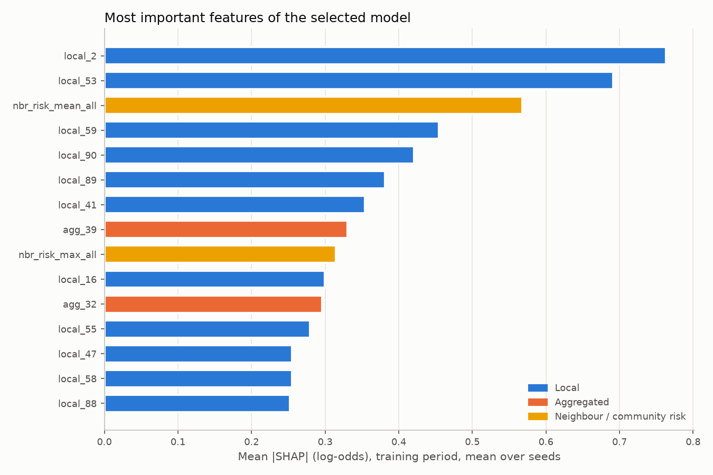
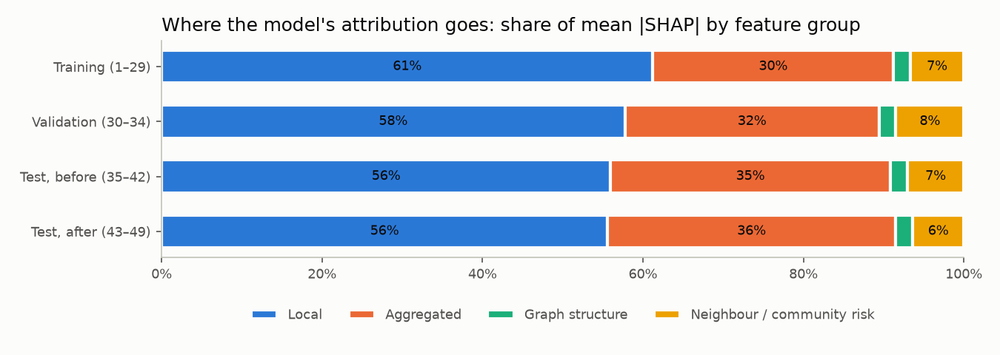

# Detailed results

The full tables and figures behind the [README](../README.md). Every table and figure
between the generated markers is written by `scripts/make_results_table.py` from the logged
MLflow runs, not typed by hand. The reasoning behind each design choice is in
[`decisions.md`](decisions.md).

All test numbers are for time steps 35–49, scored once with the model and threshold chosen on
validation (steps 30–34). Feature sets: (a) the 93 local features, (b) all 165 Elliptic
features (local + aggregated), (c) local + graph features.

- [Data exploration](#data-exploration)
- [Tabular baselines](#tabular-baselines)
- [Graph features](#graph-features)
- [GNNs and hybrid](#gnns-and-hybrid)
- [The dark-market collapse, in full](#the-dark-market-collapse-in-full)
- [Serving latency](#serving-latency)

## Data exploration

From [`notebooks/01_eda.ipynb`](../notebooks/01_eda.ipynb). All findings use the training
period (steps 1–34) except the timeline, which is shown for context only.

- **The illicit share varies a lot between steps,** from under 1% to 36% of labelled
  transactions within the training period. Illicit counts per step range from 5 to 342
  (median 84). Late in the timeline, illicit labels almost vanish (from 239 in step 42
  to between 2 and 24 in steps 43–47), consistent with the dark market shutdown reported
  by Weber et al. The [collapse analysis](#the-dark-market-collapse-in-full) investigates
  this.
- **Precision@K uses K = 20.** With K = 100, 59% of training steps have fewer than 100
  illicit transactions, so even a perfect model could not reach precision 1 there.
- **The features are already standardised** (column means ≈ 0, standard deviations ≈ 1)
  but heavily skewed: 85 of 165 have |skew| > 5. There are no constant columns, but 45
  feature pairs are near-duplicates (|r| > 0.99). This matters for logistic regression
  (unstable coefficients), not for tree models.

  
  
- **The graph is sparse and each time step is one connected component** (verified for
  all 34 training steps). Each step has about 4,000 transactions and 4,600 edges;
  78% of transactions have only 1 or 2 connections, and the busiest has 473.

  
- **There is strong homophily.** Between labelled transactions, illicit–illicit edges
  occur 2.7× more often than random pairing predicts. An illicit transaction's labelled
  neighbours are on average 55% illicit, a licit one's only 2%. So the graph carries
  signal, but 21% of labelled transactions have no labelled neighbour, and labels can't
  be used at prediction time anyway. Graph models have to work from features and
  predicted risk.

  
  

## Tabular baselines

Logistic regression, random forest and XGBoost on feature sets (a) local and
(b) local + aggregated. Each model's settings were chosen from a small grid by mean
validation PR-AUC (steps 30–34), and the decision thresholds were tuned on validation
too; test steps 35–49 were scored once, with the chosen model.

<!-- baselines:start -->
How well each tabular model ranks illicit transactions above licit ones on the test steps.

**Ranking quality** (test steps 35–49; precision/recall@K are per-step means)

| Model | Features | Seeds | Val PR-AUC | Test PR-AUC | Precision@20 | Recall@20 |
|---|---|---|---|---|---|---|
| Logistic regression | (a) local | 1 | 0.836 | 0.267 | 0.133 | 0.083 |
| Random forest | (a) local | 3 | 0.989 ± 0.000 | 0.781 ± 0.001 | 0.543 ± 0.000 | 0.176 ± 0.000 |
| XGBoost | (a) local | 3 | 0.988 ± 0.000 | 0.778 ± 0.003 | 0.550 ± 0.000 | 0.181 ± 0.001 |
| Logistic regression | (b) local + aggregated | 1 | 0.770 | 0.231 | 0.107 | 0.074 |
| Random forest | (b) local + aggregated | 3 | 0.990 ± 0.000 | 0.786 ± 0.004 | 0.545 ± 0.002 | 0.177 ± 0.001 |
| XGBoost | (b) local + aggregated | 3 | 0.990 ± 0.001 | 0.791 ± 0.000 | 0.553 ± 0.003 | 0.182 ± 0.002 |

What its decisions look like once a threshold tuned on validation turns scores into flags.

**Decisions at the validation-tuned threshold** (left: max-F1 threshold; right: cost threshold, a miss costs 10× a false alarm)

| Model | Features | Seeds | Precision | Recall | F1 | Precision (cost) | Recall (cost) | F1 (cost) |
|---|---|---|---|---|---|---|---|---|
| Logistic regression | (a) local | 1 | 0.442 | 0.641 | 0.523 | 0.199 | 0.804 | 0.319 |
| Random forest | (a) local | 3 | 0.782 ± 0.031 | 0.725 ± 0.007 | 0.752 ± 0.011 | 0.573 ± 0.022 | 0.748 ± 0.002 | 0.649 ± 0.014 |
| XGBoost | (a) local | 3 | 0.775 ± 0.012 | 0.713 ± 0.003 | 0.742 ± 0.007 | 0.459 ± 0.089 | 0.763 ± 0.018 | 0.569 ± 0.065 |
| Logistic regression | (b) local + aggregated | 1 | 0.276 | 0.706 | 0.396 | 0.177 | 0.835 | 0.292 |
| Random forest | (b) local + aggregated | 3 | 0.886 ± 0.032 | 0.710 ± 0.006 | 0.788 ± 0.014 | 0.592 ± 0.048 | 0.740 ± 0.001 | 0.657 ± 0.030 |
| XGBoost | (b) local + aggregated | 3 | 0.841 ± 0.009 | 0.731 ± 0.001 | 0.782 ± 0.003 | 0.688 ± 0.109 | 0.743 ± 0.007 | 0.711 ± 0.055 |

Mean ± sample standard deviation over seeds.
<!-- baselines:end -->

## Graph features

XGBoost (the same 8-setting grid and 3 seeds as the tabular baselines) on three graph
feature sets:

- **(c) local + graph:** the 93 local features plus in/out degree, PageRank, clustering
  coefficient, Louvain community size and density (computed by Neo4j Graph Data Science),
  and community and neighbour risk.
- **(b) + graph:** all 165 Elliptic features plus the same graph features. Graph features
  only help if this beats (b), because the 72 aggregated features are already
  neighbourhood statistics.
- **Local + structure only:** the graph's shape without any risk feature, to separate
  structure from risk passed along edges.

Neighbour and community risk use a stage-1 XGBoost model's *predicted* risk, not labels:
test transactions only connect to other test transactions, whose labels are unknown at
prediction time. Training transactions are scored out-of-fold by time step, so no
transaction's risk comes from a model that saw its time step. Louvain communities turned out
to cover most of a time step (median 5 per step, the largest holding 81% of the step on
average), so the community features say more about the step than about a local group.

<!-- graph-features:start -->
How well XGBoost ranks illicit transactions with each graph feature set.

**Ranking quality** (test steps 35–49; precision/recall@K are per-step means)

| Model | Features | Seeds | Val PR-AUC | Test PR-AUC | Precision@20 | Recall@20 |
|---|---|---|---|---|---|---|
| XGBoost | (c) local + graph | 3 | 0.993 ± 0.001 | 0.788 ± 0.001 | 0.552 ± 0.002 | 0.180 ± 0.001 |
| XGBoost | (b) + graph | 3 | 0.994 ± 0.000 | 0.795 ± 0.001 | 0.562 ± 0.002 | 0.187 ± 0.001 |
| XGBoost | local + structure only | 3 | 0.990 ± 0.000 | 0.776 ± 0.001 | 0.550 ± 0.003 | 0.179 ± 0.002 |

Its decisions at the thresholds tuned on validation.

**Decisions at the validation-tuned threshold** (left: max-F1 threshold; right: cost threshold, a miss costs 10× a false alarm)

| Model | Features | Seeds | Precision | Recall | F1 | Precision (cost) | Recall (cost) | F1 (cost) |
|---|---|---|---|---|---|---|---|---|
| XGBoost | (c) local + graph | 3 | 0.808 ± 0.036 | 0.718 ± 0.009 | 0.760 ± 0.011 | 0.607 ± 0.029 | 0.745 ± 0.004 | 0.669 ± 0.016 |
| XGBoost | (b) + graph | 3 | 0.893 ± 0.021 | 0.715 ± 0.005 | 0.794 ± 0.005 | 0.705 ± 0.079 | 0.737 ± 0.009 | 0.719 ± 0.039 |
| XGBoost | local + structure only | 3 | 0.769 ± 0.019 | 0.705 ± 0.002 | 0.736 ± 0.007 | 0.547 ± 0.072 | 0.741 ± 0.013 | 0.627 ± 0.045 |

Mean ± sample standard deviation over seeds.

What each feature set adds to XGBoost.

**XGBoost: what each feature set adds** (test steps 35–49; change = difference of seed means)

| From | To | test PR-AUC: from → to (change) | precision@20: from → to (change) | F1 (max-F1 threshold): from → to (change) |
|---|---|---|---|---|
| (a) local | (b) local + aggregated | 0.778 → 0.791 (+0.013) | 0.550 → 0.553 (+0.003) | 0.742 → 0.782 (+0.039) |
| (a) local | (c) local + graph | 0.778 → 0.788 (+0.010) | 0.550 → 0.552 (+0.002) | 0.742 → 0.760 (+0.018) |
| (a) local | local + structure only | 0.778 → 0.776 (-0.002) | 0.550 → 0.550 (+0.000) | 0.742 → 0.736 (-0.007) |
| (b) local + aggregated | (b) + graph | 0.791 → 0.795 (+0.004) | 0.553 → 0.562 (+0.009) | 0.782 → 0.794 (+0.012) |

Whether each change is larger than step-to-step noise.

**How sure is each change?** Paired bootstrap over test steps: 1000 resamples of the 15 test steps, both feature sets scored on the same resample.

| From | To | test PR-AUC change [95% interval] | precision@20 change [95% interval] | share of resamples where To has higher PR-AUC |
|---|---|---|---|---|
| (a) local | (b) local + aggregated | +0.013 [+0.003, +0.025] | +0.003 [-0.014, +0.024] | 99% |
| (a) local | (c) local + graph | +0.010 [+0.003, +0.017] | +0.002 [-0.014, +0.019] | 100% |
| (a) local | local + structure only | -0.002 [-0.007, +0.003] | +0.000 [-0.010, +0.010] | 33% |
| (b) local + aggregated | (b) + graph | +0.004 [-0.005, +0.013] | +0.009 [+0.000, +0.027] | 85% |
<!-- graph-features:end -->

## GNNs and hybrid

GCN and GraphSAGE (two message-passing layers each, PyTorch Geometric) on feature sets (a)
and (b), and a hybrid: XGBoost on the same features plus the embeddings of the better GNN
(chosen on validation). Everything goes through the same protocol as the other models: an
8-setting grid per model, 3 seeds, selection and thresholds on validation, one test score
per kept model.

- **Graph.** Edges in both directions; unknown-label transactions are in the graph but not
  in the loss or the metrics. Each period is its own subgraph, because no edge crosses
  periods.
- **Checkpoint.** The kept model is the epoch with the best validation PR-AUC, not the
  last epoch.
- **Imbalance.** Class-weighted cross-entropy and focal loss are both in the grid and
  compared on validation only.
- **Hybrid caveat.** The embeddings of training transactions come from a GNN trained on
  their labels, so they are cleaner than those of test transactions. That can only hurt
  the hybrid's test score; the train vs validation PR-AUC of each GNN is shown so the gap
  is visible.
- **Reproducible.** GNNs train on CPU with deterministic algorithms, so a refit
  reproduces its validation score exactly, as the protocol checks.

<!-- gnn:start -->
How well GCN, GraphSAGE and the hybrid rank illicit transactions on the test steps.

**Ranking quality** (test steps 35–49; precision/recall@K are per-step means)

| Model | Features | Seeds | Val PR-AUC | Test PR-AUC | Precision@20 | Recall@20 |
|---|---|---|---|---|---|---|
| GCN | (a) local | 3 | 0.909 ± 0.007 | 0.482 ± 0.030 | 0.431 ± 0.013 | 0.100 ± 0.002 |
| GraphSAGE | (a) local | 3 | 0.956 ± 0.003 | 0.577 ± 0.011 | 0.532 ± 0.008 | 0.173 ± 0.004 |
| GCN | (b) local + aggregated | 3 | 0.897 ± 0.009 | 0.464 ± 0.044 | 0.424 ± 0.014 | 0.129 ± 0.003 |
| GraphSAGE | (b) local + aggregated | 3 | 0.957 ± 0.008 | 0.526 ± 0.031 | 0.446 ± 0.003 | 0.131 ± 0.018 |
| XGBoost | (a) + GNN embeddings (hybrid) | 3 | 0.975 ± 0.000 | 0.673 ± 0.018 | 0.540 ± 0.012 | 0.177 ± 0.012 |
| XGBoost | (b) + GNN embeddings (hybrid) | 3 | 0.966 ± 0.002 | 0.649 ± 0.028 | 0.504 ± 0.017 | 0.160 ± 0.008 |

Their decisions at the thresholds tuned on validation.

**Decisions at the validation-tuned threshold** (left: max-F1 threshold; right: cost threshold, a miss costs 10× a false alarm)

| Model | Features | Seeds | Precision | Recall | F1 | Precision (cost) | Recall (cost) | F1 (cost) |
|---|---|---|---|---|---|---|---|---|
| GCN | (a) local | 3 | 0.551 ± 0.032 | 0.402 ± 0.039 | 0.464 ± 0.023 | 0.261 ± 0.027 | 0.654 ± 0.057 | 0.372 ± 0.020 |
| GraphSAGE | (a) local | 3 | 0.685 ± 0.010 | 0.578 ± 0.014 | 0.627 ± 0.011 | 0.345 ± 0.014 | 0.694 ± 0.013 | 0.460 ± 0.011 |
| GCN | (b) local + aggregated | 3 | 0.588 ± 0.040 | 0.460 ± 0.039 | 0.515 ± 0.027 | 0.409 ± 0.099 | 0.624 ± 0.060 | 0.485 ± 0.061 |
| GraphSAGE | (b) local + aggregated | 3 | 0.609 ± 0.070 | 0.576 ± 0.006 | 0.591 ± 0.031 | 0.480 ± 0.047 | 0.631 ± 0.016 | 0.544 ± 0.026 |
| XGBoost | (a) + GNN embeddings (hybrid) | 3 | 0.661 ± 0.052 | 0.602 ± 0.038 | 0.628 ± 0.007 | 0.345 ± 0.009 | 0.708 ± 0.020 | 0.463 ± 0.003 |
| XGBoost | (b) + GNN embeddings (hybrid) | 3 | 0.671 ± 0.050 | 0.566 ± 0.001 | 0.614 ± 0.020 | 0.459 ± 0.094 | 0.681 ± 0.046 | 0.542 ± 0.057 |

Mean ± sample standard deviation over seeds.

Every model and feature set of the project side by side.

**All models** (test steps 35–49; F1 at the max-F1 and the cost threshold, both tuned on validation)

| Model | Features | Seeds | Val PR-AUC | Test PR-AUC | Precision@20 | Recall@20 | F1 | F1 (cost) |
|---|---|---|---|---|---|---|---|---|
| Logistic regression | (a) local | 1 | 0.836 | 0.267 | 0.133 | 0.083 | 0.523 | 0.319 |
| Random forest | (a) local | 3 | 0.989 ± 0.000 | 0.781 ± 0.001 | 0.543 ± 0.000 | 0.176 ± 0.000 | 0.752 ± 0.011 | 0.649 ± 0.014 |
| XGBoost | (a) local | 3 | 0.988 ± 0.000 | 0.778 ± 0.003 | 0.550 ± 0.000 | 0.181 ± 0.001 | 0.742 ± 0.007 | 0.569 ± 0.065 |
| Logistic regression | (b) local + aggregated | 1 | 0.770 | 0.231 | 0.107 | 0.074 | 0.396 | 0.292 |
| Random forest | (b) local + aggregated | 3 | 0.990 ± 0.000 | 0.786 ± 0.004 | 0.545 ± 0.002 | 0.177 ± 0.001 | 0.788 ± 0.014 | 0.657 ± 0.030 |
| XGBoost | (b) local + aggregated | 3 | 0.990 ± 0.001 | 0.791 ± 0.000 | 0.553 ± 0.003 | 0.182 ± 0.002 | 0.782 ± 0.003 | 0.711 ± 0.055 |
| XGBoost | (c) local + graph | 3 | 0.993 ± 0.001 | 0.788 ± 0.001 | 0.552 ± 0.002 | 0.180 ± 0.001 | 0.760 ± 0.011 | 0.669 ± 0.016 |
| XGBoost | local + structure only | 3 | 0.990 ± 0.000 | 0.776 ± 0.001 | 0.550 ± 0.003 | 0.179 ± 0.002 | 0.736 ± 0.007 | 0.627 ± 0.045 |
| XGBoost | (b) + graph | 3 | 0.994 ± 0.000 | 0.795 ± 0.001 | 0.562 ± 0.002 | 0.187 ± 0.001 | 0.794 ± 0.005 | 0.719 ± 0.039 |
| GCN | (a) local | 3 | 0.909 ± 0.007 | 0.482 ± 0.030 | 0.431 ± 0.013 | 0.100 ± 0.002 | 0.464 ± 0.023 | 0.372 ± 0.020 |
| GCN | (b) local + aggregated | 3 | 0.897 ± 0.009 | 0.464 ± 0.044 | 0.424 ± 0.014 | 0.129 ± 0.003 | 0.515 ± 0.027 | 0.485 ± 0.061 |
| GraphSAGE | (a) local | 3 | 0.956 ± 0.003 | 0.577 ± 0.011 | 0.532 ± 0.008 | 0.173 ± 0.004 | 0.627 ± 0.011 | 0.460 ± 0.011 |
| GraphSAGE | (b) local + aggregated | 3 | 0.957 ± 0.008 | 0.526 ± 0.031 | 0.446 ± 0.003 | 0.131 ± 0.018 | 0.591 ± 0.031 | 0.544 ± 0.026 |
| XGBoost | (a) + GNN embeddings (hybrid) | 3 | 0.975 ± 0.000 | 0.673 ± 0.018 | 0.540 ± 0.012 | 0.177 ± 0.012 | 0.628 ± 0.007 | 0.463 ± 0.003 |
| XGBoost | (b) + GNN embeddings (hybrid) | 3 | 0.966 ± 0.002 | 0.649 ± 0.028 | 0.504 ± 0.017 | 0.160 ± 0.008 | 0.614 ± 0.020 | 0.542 ± 0.057 |

The loss function was part of each GNN's grid and was chosen on validation.

**Imbalance handling: weighted cross-entropy vs focal loss** (validation only; best grid setting per loss, mean over seeds)

| Model | Features | Weighted CE: best val PR-AUC | Focal: best val PR-AUC | Selected |
|---|---|---|---|---|
| GCN | (a) local | 0.909 | 0.905 | weighted CE |
| GCN | (b) local + aggregated | 0.896 | 0.897 | focal |
| GraphSAGE | (a) local | 0.956 | 0.956 | weighted CE |
| GraphSAGE | (b) local + aggregated | 0.957 | 0.957 | weighted CE |

The checkpoint kept for each GNN, and how much better it scores on its own training nodes than on validation.

**Kept GNN checkpoints** (epoch per seed, and PR-AUC on training vs validation nodes)

| Model | Features | Seeds | Kept epoch | Train PR-AUC | Val PR-AUC |
|---|---|---|---|---|---|
| GCN | (a) local | 3 | 148, 192, 228 | 0.937 ± 0.009 | 0.909 ± 0.007 |
| GCN | (b) local + aggregated | 3 | 126, 95, 107 | 0.970 ± 0.006 | 0.897 ± 0.009 |
| GraphSAGE | (a) local | 3 | 192, 378, 181 | 0.989 ± 0.003 | 0.956 ± 0.003 |
| GraphSAGE | (b) local + aggregated | 3 | 299, 166, 337 | 0.998 ± 0.001 | 0.957 ± 0.008 |

Whether the planned comparisons are larger than step-to-step noise.

**How sure is each change?** Paired bootstrap over test steps: 1000 resamples of the 15 test steps. Best GNN by validation PR-AUC: (a) local: GraphSAGE, (b) local + aggregated: GraphSAGE.

| From | To | test PR-AUC change [95% interval] | precision@20 change [95% interval] | share of resamples where To has higher PR-AUC |
|---|---|---|---|---|
| XGBoost, (a) local | GraphSAGE, (a) local | -0.202 [-0.402, -0.067] | -0.018 [-0.046, +0.016] | 0% |
| XGBoost, (b) local + aggregated | GraphSAGE, (b) local + aggregated | -0.265 [-0.383, -0.174] | -0.107 [-0.216, -0.006] | 0% |
| XGBoost, (a) local | XGBoost, (a) + GNN embeddings (hybrid) | -0.105 [-0.211, -0.045] | -0.010 [-0.033, +0.017] | 0% |
| XGBoost, (b) local + aggregated | XGBoost, (b) + GNN embeddings (hybrid) | -0.142 [-0.247, -0.083] | -0.049 [-0.119, +0.007] | 0% |
| GCN, (a) local | GraphSAGE, (a) local | +0.095 [-0.064, +0.245] | +0.101 [+0.031, +0.193] | 87% |
| GCN, (b) local + aggregated | GraphSAGE, (b) local + aggregated | +0.062 [+0.012, +0.115] | +0.022 [-0.047, +0.084] | 100% |

Illicit F1 per test step for every model built on (b).

The figure's numbers (illicit F1 per test step, mean over seeds)

| Step | Illicit | XGBoost (b) | XGBoost (b) + graph features | GCN (b) | GraphSAGE (b) | Hybrid: XGBoost (b) + embeddings |
|---|---|---|---|---|---|---|
| 35 | 182 | 0.958 | 0.964 | 0.775 | 0.841 | 0.861 |
| 36 | 33 | 0.842 | 0.850 | 0.238 | 0.397 | 0.418 |
| 37 | 40 | 0.776 | 0.761 | 0.452 | 0.566 | 0.571 |
| 38 | 111 | 0.931 | 0.935 | 0.509 | 0.683 | 0.716 |
| 39 | 81 | 0.933 | 0.908 | 0.553 | 0.584 | 0.565 |
| 40 | 112 | 0.759 | 0.763 | 0.469 | 0.546 | 0.554 |
| 41 | 116 | 0.952 | 0.919 | 0.522 | 0.604 | 0.626 |
| 42 | 239 | 0.843 | 0.871 | 0.713 | 0.750 | 0.767 |
| 43 | 24 | 0.000 | 0.000 | 0.000 | 0.000 | 0.000 |
| 44 | 24 | 0.037 | 0.044 | 0.049 | 0.047 | 0.056 |
| 45 | 5 | 0.000 | 0.000 | 0.000 | 0.000 | 0.000 |
| 46 | 2 | 0.144 | 0.207 | 0.411 | 0.056 | 0.000 |
| 47 | 22 | 0.000 | 0.000 | 0.000 | 0.025 | 0.000 |
| 48 | 36 | 0.000 | 0.000 | 0.000 | 0.000 | 0.000 |
| 49 | 56 | 0.030 | 0.032 | 0.009 | 0.011 | 0.011 |

<!-- gnn:end -->

## The dark-market collapse, in full

What was analysed, and every choice behind it, was fixed before running it. The test period
is split at the dark-market shutdown that Weber et al. (2019) report at step 43: *before* is
steps 35–42, *after* is 43–49. Everything below comes from one logged analysis run. The
conclusions are in the README's
[dark-market collapse](../README.md#the-dark-market-collapse) section.

<!-- findings:start -->
Analysis run `20261021-015826`: XGBoost on (b) + graph, the model with the best validation PR-AUC, refitted and checked against its logged scores. Mean ± std over 3 seeds.

Does the model still rank illicit transactions high after the shutdown, so that only the threshold is off?

**1. Ranking or threshold?** (labelled transactions; precision, recall and F1 at the validation-tuned threshold; recall@K and oracle F1 are per-step means; the oracle picks each step's best threshold from that step's own labels, a ceiling, not a result)

| Period | Illicit | PR-AUC | Precision | Recall | F1 | Recall@20 | Oracle F1 (diagnostic) | Median illicit score |
|---|---|---|---|---|---|---|---|---|
| Validation (30–34) | 591 | 0.994 ± 0.000 | 0.983 ± 0.003 | 0.967 ± 0.004 | 0.975 ± 0.002 | 0.371 ± 0.000 | 0.956 ± 0.002 | 0.998 ± 0.000 |
| Test before (35–42) | 914 | 0.917 ± 0.000 | 0.944 ± 0.014 | 0.844 ± 0.006 | 0.891 ± 0.003 | 0.260 ± 0.000 | 0.897 ± 0.001 | 0.998 ± 0.000 |
| Test after (43–49) | 169 | 0.043 ± 0.001 | 0.060 ± 0.011 | 0.018 ± 0.000 | 0.027 ± 0.001 | 0.103 ± 0.003 | 0.214 ± 0.008 | 0.002 ± 0.000 |

How far each feature's distribution moves away from the training period.

**2. Feature drift against the training period** (PSI per feature, all transactions)

| Period vs training | Features with PSI > 0.25 | Median PSI: local | Median PSI: aggregated | Median PSI: graph structure | Median PSI: neighbour / community risk |
|---|---|---|---|---|---|
| Validation (30–34) | 29 of 174 | 0.05 | 0.05 | 0.03 | 0.46 |
| Test before (35–42) | 28 of 174 | 0.06 | 0.04 | 0.05 | 0.29 |
| Test after (43–49) | 37 of 174 | 0.06 | 0.07 | 0.05 | 0.23 |

The features that encode time itself, and how little the model relies on them.

**Hidden clocks**: features whose per-step median moves with the time step in the training period (|Spearman| ≥ 0.95)

| Feature | Correlation of per-step median with step (training) | PSI, test after | SHAP importance rank (training) |
|---|---|---|---|
| `agg_10` | +1.000 | 8.05 | 76 of 174 |
| `agg_43` | +1.000 | 8.01 | 66 of 174 |
| `agg_44` | +1.000 | 8.07 | 36 of 174 |
| `agg_46` | +1.000 | 8.09 | 51 of 174 |
| `agg_7` | +1.000 | 7.84 | 53 of 174 |
| `agg_8` | +1.000 | 8.05 | 64 of 174 |

Whether a classifier can tell two periods apart, including two stretches of the training period.

**3–4. Adversarial validation**: can a classifier tell two periods apart? (folds grouped by time step; the training early vs late row is a control added after the first results)

| Transactions | Period A | Period B | Rows A / B | Out-of-fold AUC |
|---|---|---|---|---|
| all transactions | Training (1–29) | Test before (35–42) | 120,804 / 37,820 | 0.995 |
| all transactions | Training (1–29) | Test after (43–49) | 120,804 / 29,684 | 1.000 |
| all transactions | Training early (1–24) | Training late (25–29) | 108,950 / 11,854 | 0.999 |
| illicit only | Training (1–29) | Test before (35–42) | 2,871 / 914 | 1.000 |
| illicit only | Training (1–29) | Test after (43–49) | 2,871 / 169 | 0.999 |
| illicit only | Training early (1–24) | Training late (25–29) | 2,219 / 652 | 0.989 |

The planned model comparisons, repeated before and after the shutdown.

**5. Do the planned comparisons hold in both periods?** (paired bootstrap over the steps of each period)

| From | To | Period | test PR-AUC change [95% interval] | precision@20 change [95% interval] |
|---|---|---|---|---|
| XGBoost, (a) local | XGBoost, (b) local + aggregated | Test before (35–42) | +0.011 [+0.004, +0.018] | +0.000 [+0.000, +0.000] |
| XGBoost, (a) local | XGBoost, (b) local + aggregated | Test after (43–49) | -0.001 [-0.014, +0.015] | +0.007 [-0.024, +0.050] |
| XGBoost, (a) local | XGBoost, (c) local + graph | Test before (35–42) | +0.008 [+0.003, +0.013] | +0.000 [+0.000, +0.000] |
| XGBoost, (a) local | XGBoost, (c) local + graph | Test after (43–49) | +0.002 [-0.006, +0.012] | +0.005 [-0.031, +0.036] |
| XGBoost, (a) local | XGBoost, local + structure only | Test before (35–42) | -0.002 [-0.005, +0.002] | +0.000 [+0.000, +0.000] |
| XGBoost, (a) local | XGBoost, local + structure only | Test after (43–49) | +0.001 [-0.002, +0.003] | +0.000 [-0.021, +0.021] |
| XGBoost, (b) local + aggregated | XGBoost, (b) + graph | Test before (35–42) | +0.001 [-0.005, +0.006] | +0.000 [+0.000, +0.000] |
| XGBoost, (b) local + aggregated | XGBoost, (b) + graph | Test after (43–49) | +0.008 [+0.003, +0.022] | +0.019 [+0.000, +0.057] |
| XGBoost, (a) local | GraphSAGE, (a) local | Test before (35–42) | -0.104 [-0.209, -0.046] | -0.040 [-0.069, -0.015] |
| XGBoost, (a) local | GraphSAGE, (a) local | Test after (43–49) | -0.006 [-0.020, +0.014] | +0.007 [-0.029, +0.064] |
| XGBoost, (b) local + aggregated | GraphSAGE, (b) local + aggregated | Test before (35–42) | -0.245 [-0.380, -0.171] | -0.241 [-0.372, -0.122] |
| XGBoost, (b) local + aggregated | GraphSAGE, (b) local + aggregated | Test after (43–49) | -0.001 [-0.019, +0.029] | +0.045 [-0.014, +0.129] |
| XGBoost, (a) local | XGBoost, (a) + GNN embeddings (hybrid) | Test before (35–42) | -0.080 [-0.192, -0.026] | -0.031 [-0.056, -0.008] |
| XGBoost, (a) local | XGBoost, (a) + GNN embeddings (hybrid) | Test after (43–49) | -0.003 [-0.014, +0.003] | +0.014 [-0.017, +0.055] |
| XGBoost, (b) local + aggregated | XGBoost, (b) + GNN embeddings (hybrid) | Test before (35–42) | -0.142 [-0.261, -0.086] | -0.112 [-0.212, -0.025] |
| XGBoost, (b) local + aggregated | XGBoost, (b) + GNN embeddings (hybrid) | Test after (43–49) | -0.004 [-0.019, +0.009] | +0.024 [-0.002, +0.057] |
| GCN, (a) local | GraphSAGE, (a) local | Test before (35–42) | +0.152 [+0.090, +0.269] | +0.181 [+0.073, +0.337] |
| GCN, (a) local | GraphSAGE, (a) local | Test after (43–49) | +0.002 [-0.009, +0.021] | +0.010 [-0.038, +0.052] |
| GCN, (b) local + aggregated | GraphSAGE, (b) local + aggregated | Test before (35–42) | +0.044 [-0.005, +0.137] | +0.011 [-0.110, +0.121] |
| GCN, (b) local + aggregated | GraphSAGE, (b) local + aggregated | Test after (43–49) | -0.009 [-0.035, +0.013] | +0.033 [-0.012, +0.095] |

Which features the model relies on, and whether that changes over time.

**6. SHAP** (TreeSHAP, log-odds scale)

| Period | Local | Aggregated | Graph structure | Neighbour / community risk | Rank correlation of feature importance with training |
|---|---|---|---|---|---|
| Training (1–29) | 0.612 ± 0.003 | 0.300 ± 0.002 | 0.021 ± 0.002 | 0.067 ± 0.000 | – |
| Validation (30–34) | 0.577 ± 0.005 | 0.317 ± 0.005 | 0.021 ± 0.002 | 0.085 ± 0.000 | 0.969 ± 0.003 |
| Test before (35–42) | 0.560 ± 0.005 | 0.349 ± 0.006 | 0.021 ± 0.002 | 0.070 ± 0.000 | 0.963 ± 0.004 |
| Test after (43–49) | 0.556 ± 0.005 | 0.359 ± 0.006 | 0.021 ± 0.002 | 0.064 ± 0.001 | 0.965 ± 0.003 |

The illicit transactions the model misses, and how they differ from the ones it catches.

**7. False negatives** (illicit test transactions below the validation-tuned threshold)

| Period | Illicit | Missed (per seed) | Share missed | Median score, missed | Median score, caught | Threshold |
|---|---|---|---|---|---|---|
| Test before (35–42) | 914 | 146 / 146 / 136 | 0.156 ± 0.006 | 0.013 ± 0.000 | 0.999 ± 0.000 | 0.775 ± 0.040 |
| Test after (43–49) | 169 | 166 | 0.982 ± 0.000 | 0.002 ± 0.000 | 0.959 ± 0.013 | 0.775 ± 0.040 |
| All test (35–49) | 1083 | 312 / 312 / 302 | 0.285 ± 0.005 | 0.004 ± 0.001 | 0.999 ± 0.000 | 0.775 ± 0.040 |

Missed vs caught: graph context (medians) and mean signed SHAP per feature group (negative pushes towards licit)

| Illicit test transactions | Count (per seed) | Median degree | Median neighbour risk, mean | Median neighbour risk, max | Mean SHAP: local | Mean SHAP: aggregated | Mean SHAP: graph structure | Mean SHAP: neighbour / community risk |
|---|---|---|---|---|---|---|---|---|
| Missed | 312 / 312 / 302 | 1.000 ± 0.000 | 0.002 ± 0.000 | 0.004 ± 0.000 | -3.064 ± 0.028 | -1.839 ± 0.056 | -0.007 ± 0.020 | -0.615 ± 0.030 |
| Caught | 771 / 771 / 781 | 1.000 ± 0.000 | 0.089 ± 0.006 | 0.118 ± 0.000 | 4.921 ± 0.118 | 0.505 ± 0.034 | 0.054 ± 0.028 | 0.444 ± 0.012 |

Largest feature differences, missed vs caught (standardised mean difference): `local_5` (+2.23), `local_14` (+2.23), `local_53` (+2.15), `local_55` (+2.01), `agg_21` (+1.90), `local_54` (+1.68), `agg_8` (+1.46), `agg_10` (+1.46), `agg_7` (+1.46), `agg_63` (+1.32).

Of the 1083 illicit test transactions, 300 are missed by all three seeds and 764 by none; 19 depend on the seed.

Would another model have caught XGBoost's misses? (each at its own validation threshold, seed matched to seed)

| Other model | Period | XGBoost misses (per seed) | Of those, flagged by the other model (per seed) | Other model's own recall |
|---|---|---|---|---|
| GraphSAGE, (b) local + aggregated | Test before (35–42) | 146 / 146 / 136 | 16 / 16 / 14 | 0.681 ± 0.007 |
| GraphSAGE, (b) local + aggregated | Test after (43–49) | 166 | 1 / 0 / 0 | 0.012 ± 0.000 |
| XGBoost, (b) + GNN embeddings (hybrid) | Test before (35–42) | 146 / 146 / 136 | 17 / 14 / 14 | 0.669 ± 0.001 |
| XGBoost, (b) + GNN embeddings (hybrid) | Test after (43–49) | 166 | 0 | 0.008 ± 0.003 |

What retraining on each new step's labels would have recovered.

**8. Retraining simulation** (uses test-period labels, so not comparable with the results above)

| Period | Model | Illicit | Precision | Recall | F1 |
|---|---|---|---|---|---|
| Test before (35–42) | Frozen | 914 | 0.915 ± 0.004 | 0.863 ± 0.002 | 0.888 ± 0.001 |
| Test before (35–42) | Retrained | 914 | 0.951 ± 0.009 | 0.855 ± 0.001 | 0.901 ± 0.003 |
| Test after (43–49) | Frozen | 169 | 0.038 ± 0.003 | 0.018 ± 0.000 | 0.024 ± 0.001 |
| Test after (43–49) | Retrained | 169 | 0.538 ± 0.050 | 0.179 ± 0.019 | 0.268 ± 0.017 |

Per step

| Step | Illicit | F1 frozen | F1 retrained | PR-AUC frozen | PR-AUC retrained |
|---|---|---|---|---|---|
| 35 | 182 | 0.958 | 0.958 | 0.992 | 0.992 |
| 36 | 33 | 0.842 | 0.861 | 0.988 | 0.993 |
| 37 | 40 | 0.776 | 0.768 | 0.859 | 0.857 |
| 38 | 111 | 0.931 | 0.939 | 0.951 | 0.952 |
| 39 | 81 | 0.933 | 0.953 | 0.957 | 0.963 |
| 40 | 112 | 0.759 | 0.780 | 0.764 | 0.768 |
| 41 | 116 | 0.952 | 0.960 | 0.965 | 0.964 |
| 42 | 239 | 0.843 | 0.864 | 0.885 | 0.895 |
| 43 | 24 | 0.000 | 0.000 | 0.038 | 0.094 |
| 44 | 24 | 0.037 | 0.062 | 0.031 | 0.072 |
| 45 | 5 | 0.000 | 0.000 | 0.007 | 0.023 |
| 46 | 2 | 0.144 | 0.429 | 0.118 | 0.512 |
| 47 | 22 | 0.000 | 0.054 | 0.038 | 0.247 |
| 48 | 36 | 0.000 | 0.279 | 0.160 | 0.561 |
| 49 | 56 | 0.030 | 0.490 | 0.174 | 0.714 |

<!-- findings:end -->

## Serving latency

Response times of the investigator API on both graph backends, from
`scripts/measure_latency.py`, logged to MLflow.

<!-- latency:start -->
| Endpoint | Neo4j (full stack) p50 / p95 (ms) | in-memory p50 / p95 (ms) |
|---|---|---|
| transaction | 2.8 / 3.2 | 3.1 / 4.4 |
| neighbourhood (2 hops) | 7.8 / 20.9 | 5.0 / 8.6 |
| alerts (k = 20) | 3.6 / 4.7 | 3.6 / 4.9 |
| communities | 7.9 / 14.7 | 5.1 / 6.2 |
| fan-in | 8.0 / 12.7 | 4.5 / 6.7 |
| paths | 3.3 / 4.5 | 3.0 / 11.5 |

100 requests per endpoint after 10 warm-up requests; one sequential requests.Session, same machine; `macOS-15.7.7-arm64-arm-64bit`. Model `xgboost-all+graph-seed0-20261020-173637`.
<!-- latency:end -->
